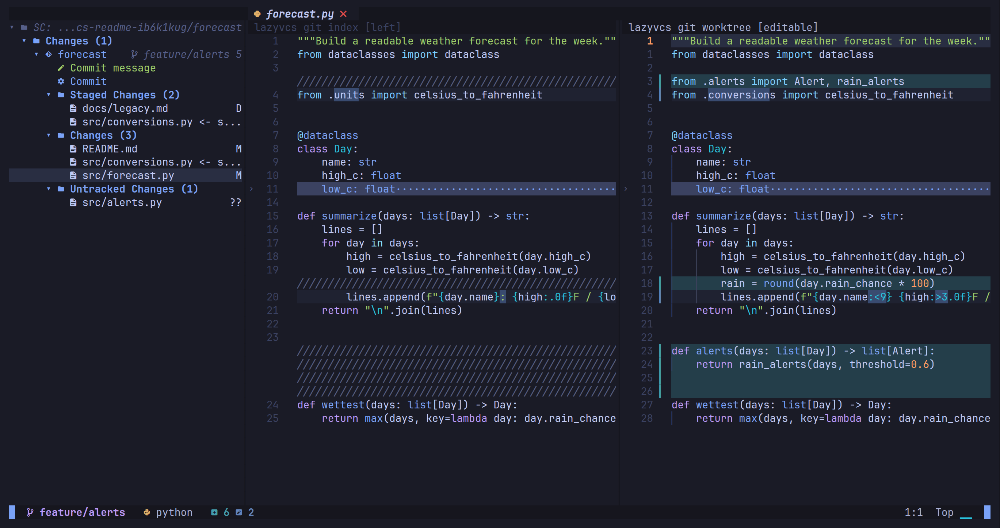
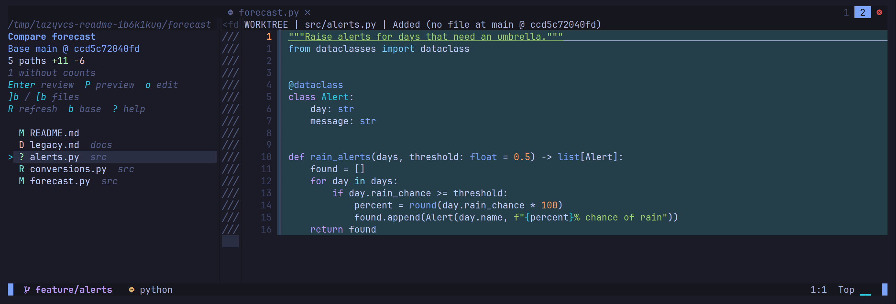
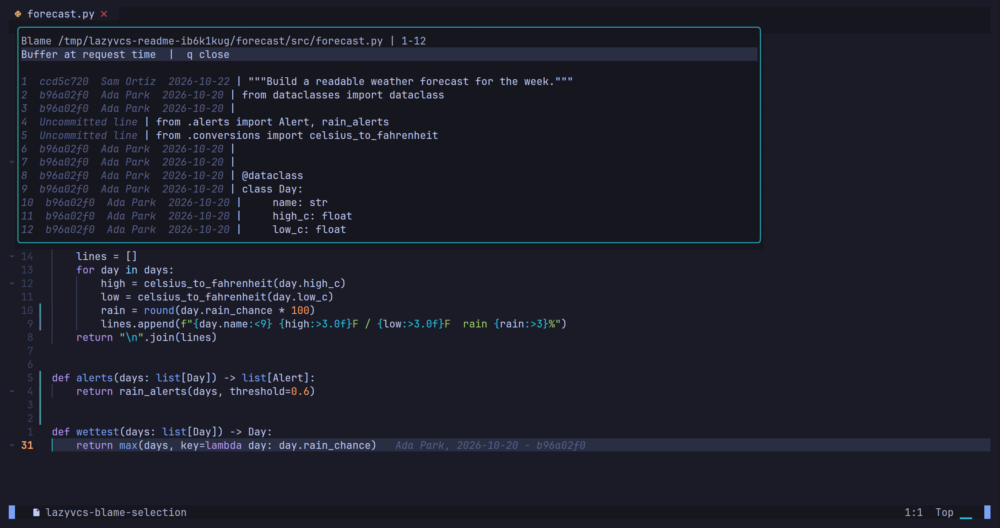

# lazyvcs.nvim

[](https://github.com/Reddimus/lazyvcs.nvim/actions/workflows/ci.yml)
[](https://github.com/Reddimus/lazyvcs.nvim/releases/latest)

Git and Subversion workflows in Neovim. Browse changes, edit diffs, compare
branches, stage files, commit, and follow blame. Works in vanilla Neovim and
AstroNvim on Linux, macOS, and Windows, without required Lua dependencies.



## Install

Requires **Neovim 0.11+** and `git` or `svn`. Windows requires LuaJIT, included
in standard Neovim builds. A Nerd Font is optional.

For AstroNvim, save this as `lua/plugins/lazyvcs.lua`. With lazy.nvim, add the
inner spec to your plugin list:

```lua
return {
  {
    "Reddimus/lazyvcs.nvim",
    version = "^0.13",
    main = "lazyvcs",
    cmd = "LazyVCS",
    event = { "BufReadPost", "BufNewFile", "BufReadCmd lazyvcs://compare/*" },
    keys = {
      { "<leader>vs", "<cmd>LazyVCS<cr>", desc = "VCS sidebar" },
      { "<leader>vo", "<cmd>LazyVCS diff open<cr>", desc = "Live diff" },
      { "<leader>vc", "<cmd>LazyVCS compare<cr>", desc = "Compare branches" },
      { "<leader>vC", "<cmd>LazyVCS compare base<cr>", desc = "Choose base" },
      { "<leader>vb", "<cmd>LazyVCS blame toggle<cr>", desc = "Toggle blame" },
    },
    opts = {},
  },
}
```

Restart Neovim and run `:checkhealth lazyvcs`. See `:help lazyvcs-configuration`
for options and optional integrations.

## Start here

Start Neovim in your project's working directory and open a file:

| Command                 | Use it to                                  |
| ----------------------- | ------------------------------------------ |
| `:LazyVCS`              | Browse repositories, files, and actions    |
| `:LazyVCS diff open`    | Edit beside the Git index or SVN BASE      |
| `:LazyVCS compare`      | Review changes across files                |
| `:LazyVCS patch`        | Copy or save the working directory's patch |
| `:LazyVCS blame toggle` | See who changed the current line           |

Press `<Tab>` after `:LazyVCS ` for completion and `?` in the sidebar for keys.
The sidebar uses `c` to commit, `b` to switch branches or SVN targets, `C` to
compare the selected repository, `R` to refresh, and `.` for repository actions.
After a failed action, press `.` and choose **Show Last Error**.

## Review and edit

By default, Compare edits supported real files on the right and keeps the base
read-only. Normal motions, search, undo, and `:write` work. Edited buffers
survive closing the view. Press Enter to review a file; first visits start at
its first hunk when available. Other paths stay read-only or explain why text is
unavailable.

- `]v` / `[v`: next / previous hunk.
- `]b` / `[b`: next / previous file in Compare, remembering your position.
- `<leader>vf`: return to Compare's file list.
- `q`: close Compare from its file list, or close live diff. From a Compare
  pane, use `:LazyVCS compare close`. Live diff also has `<leader>vr` to revert
  a hunk.

For Git, the base is the common ancestor of HEAD and the chosen branch. Compare
prompts when no base is remembered; `:LazyVCS compare base` changes the choice.
SVN supports repository URLs and revisions. Save and refresh to discover new
paths.

Confirmed-absent sides of text comparisons collapse to a narrow strip. Focus the
strip to expand it:



## Patches and blame

`:LazyVCS patch [path]` shows saved Git or Subversion changes, including
untracked files that are not ignored. By default, it uses the current window's
working directory. Pass a file or directory to choose the scope, including a
directory containing several repositories. Use `Y` to copy the whole patch, `R`
to refresh, or Enter to open a file at its hunk. Normal `y` motions still work.
Apply a copied patch with your VCS tools. Windows SVN patches currently require
ASCII repository-relative paths; Unicode file content is supported.

Inline blame follows your edits. Use `:LazyVCS blame split` for the whole file,
or select lines and run `:LazyVCS blame` for their attribution.



## More

`:help lazyvcs` covers configuration, integrations, safety checks, and limits.
AI commit messages and Snacks, fzf-lua, gitsigns, and Resession integrations are
optional.

[Contributing](CONTRIBUTING.md) · [Changelog](CHANGELOG.md) ·
[Security](SECURITY.md)
